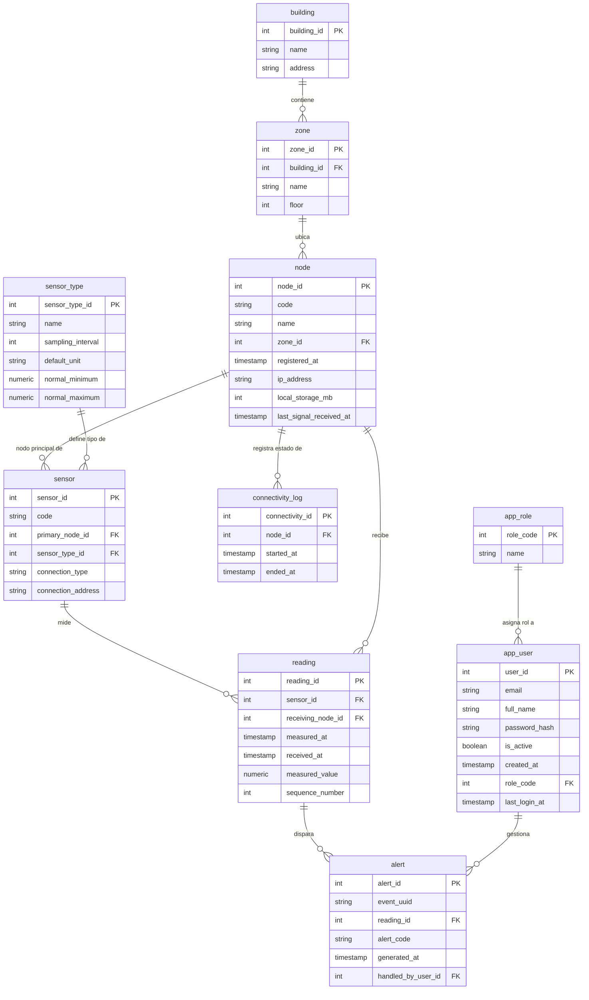

# Documentación del Esquema de Base de Datos

A continuación se detalla el diseño de la base de datos extracted del diagrama, incluyendo el propósito de cada tabla, sus atributos con sus tipos de datos inferidos (clave primaria, clave foránea, numérico, texto, fecha/hora, booleano) y las relaciones entre ellas.

---

## 1. Tablas y Atributos

### 🏢 `building`
Representa un edificio físico donde se instalan las zonas y nodos.

| Atributo | Tipo de Dato | Tipo de Clave / Nota | Descripción |
| :--- | :--- | :--- | :--- |
| `building_id` | Entero (`123`) | **PK** | Identificador único del edificio |
| `name` | Texto (`A-Z`) | | Nombre del edificio |
| `address` | Texto (`A-Z`) | | Dirección física |

---

### 📍 `zone`
Ubicación o área específica dentro de un edificio.

| Atributo | Tipo de Dato | Tipo de Clave / Nota | Descripción |
| :--- | :--- | :--- | :--- |
| `zone_id` | Entero (`123`) | **PK** | Identificador único de la zona |
| `building_id` | Entero (`123`) | **FK** (`building.building_id`) | Edificio al que pertenece la zona |
| `name` | Texto (`A-Z`) | | Nombre o etiqueta de la zona |
| `floor` | Entero (`123`) | | Número de piso o nivel |

---

### 📡 `node`
Dispositivo concetrador/gateway que gestiona sensores y reporta mediciones.

| Atributo | Tipo de Dato | Tipo de Clave / Nota | Descripción |
| :--- | :--- | :--- | :--- |
| `node_id` | Entero (`123`) | **PK** | Identificador único del nodo |
| `code` | Texto (`A-Z`) | | Código/Alias identificador del nodo |
| `name` | Texto (`A-Z`) | | Nombre descriptivo del nodo |
| `zone_id` | Entero (`123`) | **FK** (`zone.zone_id`) | Zona en la que está ubicado el nodo |
| `registered_at` | Timestamp (`🕓`) | | Fecha/Hora de registro en el sistema |
| `ip_address` | Texto (`📄`) | | Dirección IP del nodo |
| `local_storage_mb` | Entero (`123`) | | Capacidad de almacenamiento local (MB) |
| `last_signal_received_at` | Timestamp (`🕓`) | | Última vez que emitió señal de vida |

---

### 📊 `connectivity_log`
Registro histórico de estado de conexión/desconexión de un nodo.

| Atributo | Tipo de Dato | Tipo de Clave / Nota | Descripción |
| :--- | :--- | :--- | :--- |
| `connectivity_id` | Entero (`123`) | **PK** | Identificador del evento de conectividad |
| `node_id` | Entero (`123`) | **FK** (`node.node_id`) | Nodo al que pertenece la traza de conexión |
| `started_at` | Timestamp (`🕓`) | | Hora de inicio de la sesión/conexión |
| `ended_at` | Timestamp (`🕓`) | | Hora de fin de la sesión/conexión |

---

### 🏷️ `sensor_type`
Catálogo de tipos/modelos de sensores y sus parámetros por defecto.

| Atributo | Tipo de Dato | Tipo de Clave / Nota | Descripción |
| :--- | :--- | :--- | :--- |
| `sensor_type_id` | Entero (`123`) | **PK** | Identificador del tipo de sensor |
| `name` | Texto (`A-Z`) | | Nombre/Categoría del tipo de sensor |
| `sampling_interval` | Entero (`123`) | | Frecuencia de muestreo habitual |
| `default_unit` | Texto (`A-Z`) | | Unidad de medida por defecto (ej. °C, %, ppm) |
| `normal_minimum` | Entero/Flotante (`123`) | | Valor normal mínimo esperado |
| `normal_maximum` | Entero/Flotante (`123`) | | Valor normal máximo esperado |

---

### 🌡️ `sensor`
Sensor físico individual desplegado e instalado.

| Atributo | Tipo de Dato | Tipo de Clave / Nota | Descripción |
| :--- | :--- | :--- | :--- |
| `sensor_id` | Entero (`123`) | **PK** | Identificador único del sensor |
| `code` | Texto (`A-Z`) | | Código único del sensor |
| `primary_node_id` | Entero (`123`) | **FK** (`node.node_id`) | Nodo principal al que envía sus datos |
| `sensor_type_id` | Entero (`123`) | **FK** (`sensor_type.sensor_type_id`) | Tipo de sensor |
| `connection_type` | Texto (`A-Z`) | | Tipo de conexión (ej. RS485, Zigbee, Modbus) |
| `connection_address` | Texto (`A-Z`) | | Dirección física o lógica de conexión |

---

### 📈 `reading`
Captura histórica de cada lectura realizada por un sensor.

| Atributo | Tipo de Dato | Tipo de Clave / Nota | Descripción |
| :--- | :--- | :--- | :--- |
| `reading_id` | Entero (`123`) | **PK** | Identificador de la lectura |
| `sensor_id` | Entero (`123`) | **FK** (`sensor.sensor_id`) | Sensor que tomó la lectura |
| `receiving_node_id` | Entero (`123`) | **FK** (`node.node_id`) | Nodo que recepcionó la lectura |
| `measured_at` | Timestamp (`🕓`) | | Fecha y hora de medición en origen |
| `received_at` | Timestamp (`🕓`) | | Fecha y hora de recepción en el servidor/nodo |
| `measured_value` | Entero/Flotante (`123`) | | Valor medido |
| `sequence_number` | Entero (`123`) | | Número secuencial del paquete/lectura |

---

### 🚨 `alert`
Alertas o incidencias generadas a partir de una lectura anómala.

| Atributo | Tipo de Dato | Tipo de Clave / Nota | Descripción |
| :--- | :--- | :--- | :--- |
| `alert_id` | Entero (`123`) | **PK** | Identificador de la alerta |
| `event_uuid` | Texto/UUID (`A-Z`) | | Identificador único universal del evento |
| `reading_id` | Entero (`123`) | **FK** (`reading.reading_id`) | Lectura que disparó la alerta |
| `alert_code` | Texto (`A-Z`) | | Código o tipo de la alerta |
| `generated_at` | Timestamp (`🕓`) | | Fecha/Hora de generación de la alerta |
| `handled_by_user_id` | Entero (`123`) | **FK** (`app_user.user_id`) | Usuario que atendió/gestionó la alerta |

---

### 👤 `app_user`
Usuarios registrados en el sistema.

| Atributo | Tipo de Dato | Tipo de Clave / Nota | Descripción |
| :--- | :--- | :--- | :--- |
| `user_id` | Entero (`123`) | **PK** | Identificador del usuario |
| `email` | Texto (`A-Z`) | | Correo electrónico |
| `full_name` | Texto (`A-Z`) | | Nombre completo |
| `password_hash` | Texto (`A-Z`) | | Hash de la contraseña |
| `is_active` | Booleano (`☑`) | | Estado activo/inactivo |
| `created_at` | Timestamp (`🕓`) | | Fecha de creación del usuario |
| `role_code` | Entero (`123`) | **FK** (`app_role.role_code`) | Rol asignado al usuario |
| `last_login_at` | Timestamp (`🕓`) | | Fecha/Hora del último inicio de sesión |

---

### 🔑 `app_role`
Roles de seguridad y permisos para los usuarios.

| Atributo | Tipo de Dato | Tipo de Clave / Nota | Descripción |
| :--- | :--- | :--- | :--- |
| `role_code` | Entero (`123`) | **PK** | Código identificador del rol |
| `name` | Texto (`A-Z`) | | Nombre del rol (ej. admin, operator, viewer) |

---

## 2. Resumen de Relaciones (Cardinalidades)

1. **`building` 1 : N `zone`**
   - Un edificio puede contener múltiples zonas (`zone.building_id`).
   - Cada zona pertenece a un solo edificio.

2. **`zone` 1 : N `node`**
   - Una zona puede albergar varios nodos (`node.zone_id`).
   - Cada nodo se encuentra en una única zona.

3. **`node` 1 : N `sensor`**
   - Un nodo actúa como nodo principal (`primary_node_id`) para múltiples sensores.
   - Cada sensor está vinculado principalmente a un nodo.

4. **`sensor_type` 1 : N `sensor`**
   - Un tipo de sensor puede aplicarse a múltiples sensores físicos (`sensor.sensor_type_id`).

5. **`node` 1 : N `connectivity_log`**
   - Un nodo genera múltiples registros en el historial de conectividad (`connectivity_log.node_id`).

6. **`sensor` 1 : N `reading`**
   - Un sensor genera múltiples lecturas a lo largo del tiempo (`reading.sensor_id`).

7. **`node` 1 : N `reading`**
   - Un nodo puede recibir y transmitir múltiples lecturas (`reading.receiving_node_id`).

8. **`reading` 1 : N `alert`**
   - Una lectura puede desencadenar una o varias alertas (`alert.reading_id`).

9. **`app_user` 1 : N `alert`**
   - Un usuario de la aplicación puede atender/gestionar múltiples alertas (`alert.handled_by_user_id`).

10. **`app_role` 1 : N `app_user`**
    - Un rol puede estar asignado a múltiples usuarios (`app_user.role_code`).

---

## 3. Diagrama Mermaid ER

