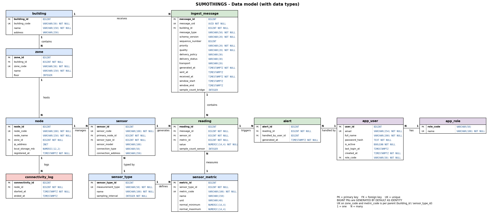

# Success Database

## Overview

This folder contains the PostgreSQL database configuration and files required to set up the `success` database for local development.

The database runs in Docker using PostgreSQL 16. Each developer can create and run their own local database instance without needing access to another developer's Docker container.

## Files

| File | Description |
|---|---|
| `compose.yaml` | Docker Compose configuration for running PostgreSQL. |
| `.gitignore` | Defines files and directories that Git should ignore. |
| `success_db.sql` | SQL script containing the database schema and related definitions. |
| `success.dump` | PostgreSQL custom-format backup of the current schema (structure only, no data). Review its contents before sharing or restoring it. |
| `succ_sum_db_final_types.png` | Data model diagram showing every column with its data type. |
| `.env` | Local environment variables and credentials. This file must not be committed to Git. |
| `.env.example` | Example environment variables for developers to use when creating their own `.env` file. |

## Database schema

The schema has 12 tables, designed so that each JSON message sent by the bridge can be stored and traced back to its building, sensors and metrics.



### Tables

| Group | Table | Purpose |
|---|---|---|
| Structure | `building` | Monitored buildings, identified by a unique `building_code`. |
| Structure | `zone` | Zones (and floors) inside a building. `zone_code` is unique per building. |
| Structure | `node` | Bridge nodes installed in a zone, with IP address and local storage. |
| Sensors | `sensor_type` | Kind of measurement (`measurement_type`, e.g. temperature, air_quality, motion, electrical) and its sampling interval in seconds. |
| Sensors | `sensor_metric` | One row per variable a sensor type sends (e.g. `average_avg_c`, `tvoc_avg_ppb`), with unit and normal minimum/maximum. `metric_code` is unique per sensor type. |
| Sensors | `sensor` | Physical sensors, linked to their primary node and sensor type, with model and connection details. |
| Ingestion | `ingest_message` | Envelope of each received JSON: `message_uid` (used for deduplication), type, schema version, sequence number, priority, quality, delivery fields, timestamps and the sampling window. |
| Ingestion | `reading` | One row per metric of each sensor in each message. Booleans are stored as `0` / `1`. |
| Alerts | `alert` | Alert generated from a reading, optionally handled by a user. |
| Users | `app_user` | Application users, with a password hash, active flag and role. |
| Users | `app_role` | Roles, identified by `role_code`. |
| Monitoring | `connectivity_log` | Periods in which a node was connected (`started_at` / `ended_at`). |

### Relationships

- `building` 1 → N `zone` → N `node` (a node belongs to one zone).
- `building` 1 → N `ingest_message` → N `reading`.
- `node` 1 → N `sensor` (via `primary_node_id`) and `node` 1 → N `connectivity_log`.
- `sensor_type` 1 → N `sensor` and `sensor_type` 1 → N `sensor_metric`.
- `sensor` 1 → N `reading` and `sensor_metric` 1 → N `reading`.
- `reading` 1 → N `alert`, and `app_user` 1 → N `alert` (handler, optional).
- `app_role` 1 → N `app_user`.

### Conventions and rules

- Primary keys are `BIGINT GENERATED BY DEFAULT AS IDENTITY`, except `app_role`, whose key is `role_code`.
- Timestamps use `TIMESTAMPTZ`; `received_at`, `registered_at` and `created_at` default to the current time and are set by the backend.
- `message_uid` is a `UUID`. If real messages do not carry valid UUIDs, change it to `VARCHAR(100)`.
- Store a secure hash (Argon2id or bcrypt) in `password_hash`, never plaintext.
- Foreign keys use `ON DELETE RESTRICT`, except `alert.handled_by_user_id`, which is set to `NULL` when the user is deleted.
- The backend must check that `reading.metric_id` belongs to the sensor's type (`sensor_metric.sensor_type_id = sensor.sensor_type_id`) and that all rows of the same sensor and message carry the same `sample_count_sensor`.

## Requirements

- Docker Desktop
- Docker Compose
- Git

## Setup

### 1. Configure environment variables

Create a local `.env` file in the same directory as `compose.yaml`.

Use `.env.example` as a template and configure the following variables:

```dotenv
POSTGRES_DB=success
POSTGRES_USER=admin
POSTGRES_PASSWORD=change_me
```

Replace `change_me` with a strong, private password. Do not commit the real `.env` file.

### 2. Start PostgreSQL

From this directory, run:

```bash
docker compose up -d
```

This starts the PostgreSQL container in the background.

### 3. Verify the container

Check its status:

```bash
docker compose ps
```

Check whether PostgreSQL is ready:

```bash
docker exec success_db pg_isready -U admin -d success
```

### 4. Connect to the database

Connect through the container with:

```bash
docker exec -it success_db psql -U admin -d success
```

The configured host port is `5432`, bound to `127.0.0.1`. This makes the database accessible from the local machine, not directly from other computers on the network.

## Database files and restoration

- Use `success_db.sql` to create the database structure from the SQL definitions.
- Use `success.dump` when a backup-based restoration is required, after verifying that it is appropriate for the target environment.
- The current dump contains only the schema, but check any future dump before sharing it, since it could include records or other sensitive information.
- Back up any important local data before replacing or restoring a database.

A custom-format PostgreSQL dump can generally be restored using `pg_restore`. The exact command depends on how the backup was created and whether the target database already exists.

## Security guidelines

- Never commit real passwords, API keys, tokens, or other secrets.
- Keep `.env` out of version control.
- Commit `.env.example` only with placeholder values.
- Review database backups before uploading or sharing them.
- Do not commit PostgreSQL data directories or Docker volumes.
- If a real credential has already been committed, removing it from the current file is not enough. Rotate the credential and assess whether the Git history also needs to be cleaned up.

## Team workflow

Each developer should clone the repository, configure their own `.env` file, and start their own local PostgreSQL instance with Docker Compose.

The repository shares the configuration and database files needed for development. It does not share a running Docker container or a live database connection.

## Notes

The default database name, username, and port are configured for local development. Coordinate any changes to the database schema or setup with the backend team.
